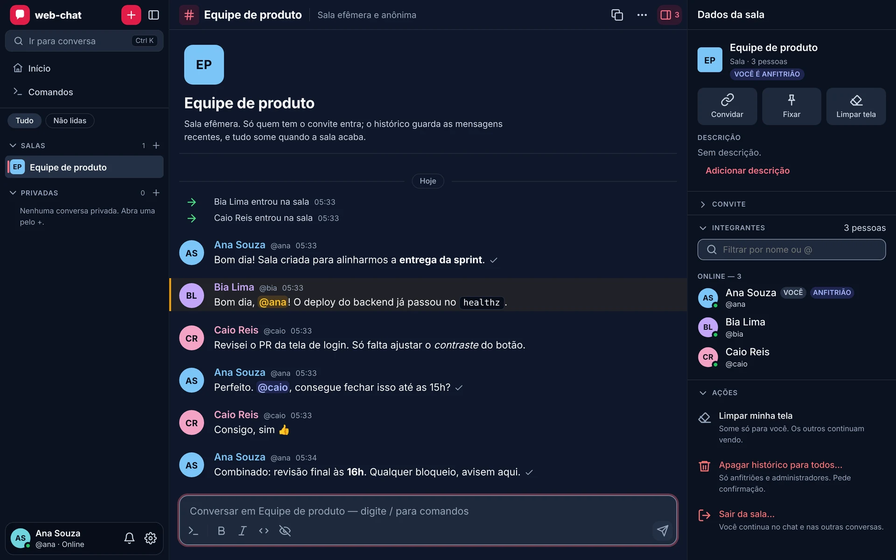
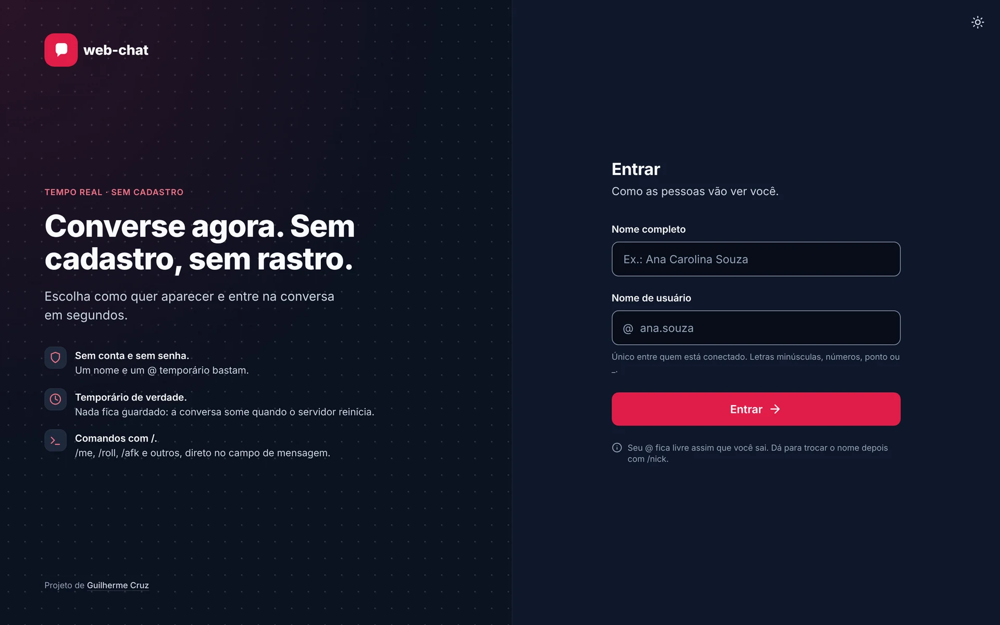
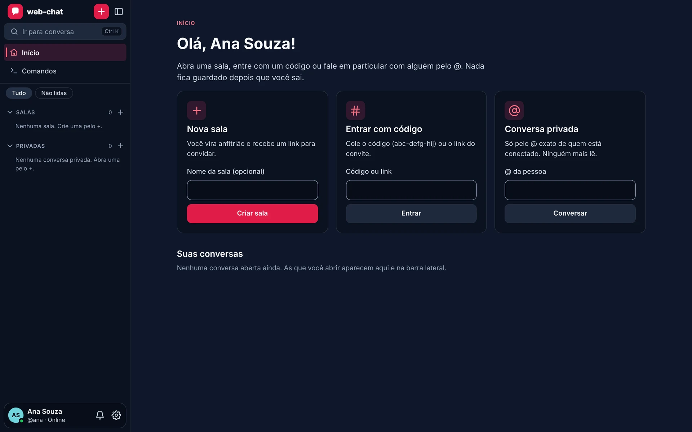
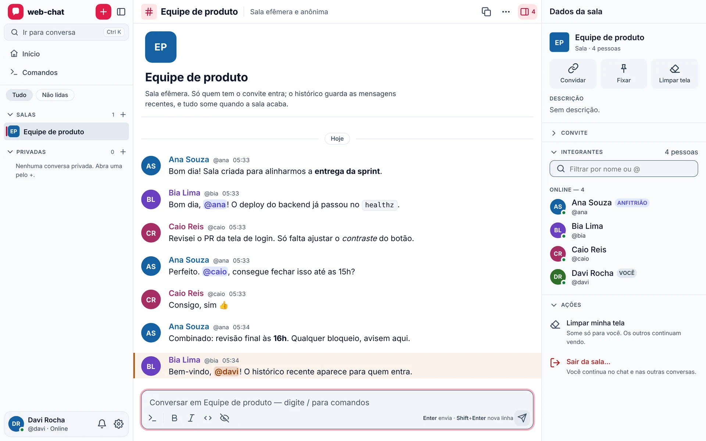
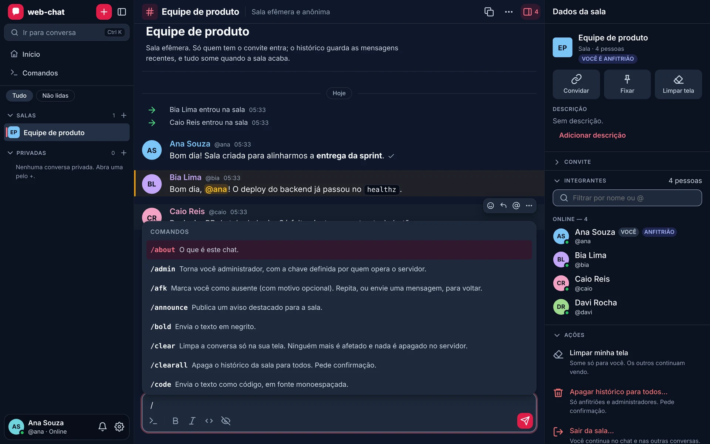
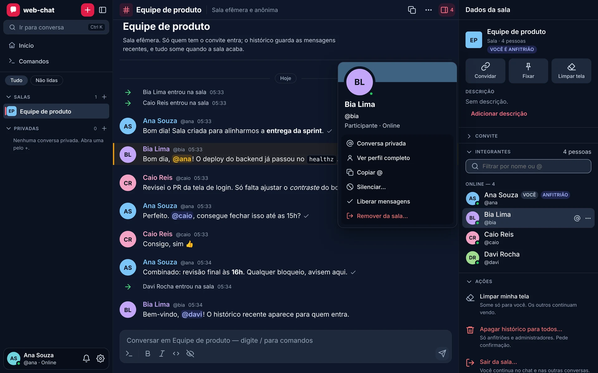
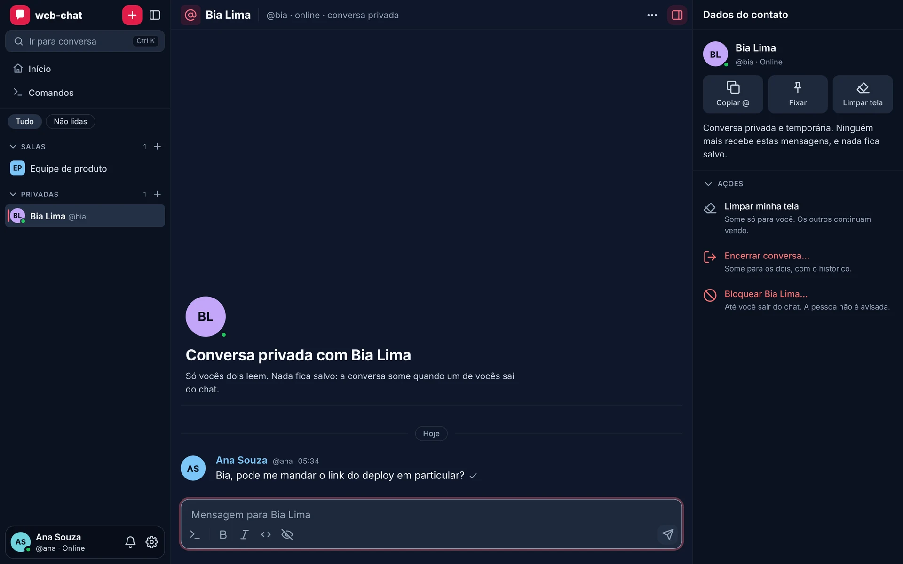
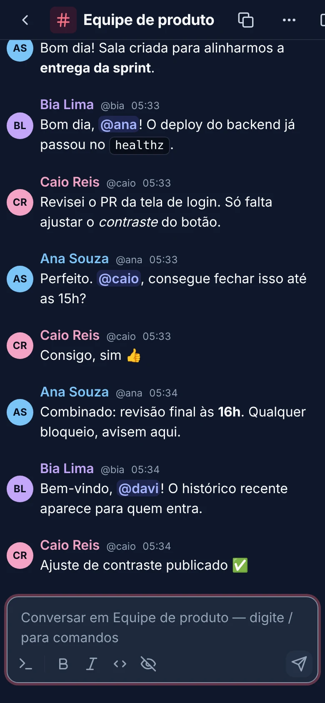

<h1 align="center">Web Chat</h1>

<p align="center">
  Chat em tempo real com salas por convite e conversas privadas — <strong>efêmero, anônimo e sem cadastro</strong>.<br>
  Frontend em JavaScript nativo (sem framework) · Backend Node.js com WebSocket.
</p>

<div align="center">

[](https://webchat.gcruz.dev.br)
[](https://github.com/https-shini/web-chat/actions/workflows/ci.yml)
[](LICENSE)

</div>



<p align="center">
  <a href="https://webchat.gcruz.dev.br"><strong>Acessar a aplicação</strong></a> ·
  <a href="docs/PROTOCOLO.md">Protocolo WebSocket</a> ·
  <a href="docs/CHAT_COMMANDS.md">Comandos do chat</a> ·
  <a href="docs/DEPLOY_RENDER.md">Deploy</a>
</p>

---

## Sumário

- [Sobre o projeto](#sobre-o-projeto)
- [Problema e proposta](#problema-e-proposta)
- [Funcionalidades](#funcionalidades)
- [Capturas de tela](#capturas-de-tela)
- [Tecnologias](#tecnologias)
- [Arquitetura](#arquitetura)
- [Pré-requisitos](#pré-requisitos)
- [Instalação](#instalação)
- [Variáveis de ambiente](#variáveis-de-ambiente)
- [Execução local](#execução-local)
- [Testes e qualidade](#testes-e-qualidade)
- [Build e produção](#build-e-produção)
- [Exemplos de uso](#exemplos-de-uso)
- [Limitações conhecidas](#limitações-conhecidas)
- [Documentação complementar](#documentação-complementar)
- [Licença](#licença)

## Sobre o projeto

O Web Chat é uma aplicação de conversa em tempo real em que a pessoa entra só com um nome e um `@username`, cria salas acessíveis por código de convite e conversa em particular com quem estiver conectado. Não há conta, senha nem banco de dados: tudo vive na memória do servidor e desaparece quando a sala esvazia ou o servidor reinicia.

O objetivo técnico é demonstrar comunicação em tempo real com um protocolo próprio sobre WebSocket, permissões verificadas no servidor e uma interface acessível construída apenas com HTML, CSS e JavaScript nativos — a única dependência de runtime do frontend é o `@floating-ui/dom`, usado para posicionar menus.

## Problema e proposta

Ferramentas de chat costumam exigir cadastro e guardar histórico indefinidamente. O Web Chat atende ao cenário oposto: conversas rápidas e descartáveis, em que basta compartilhar um link de convite (`…/#/s/abc-defg-hij`) e nada fica registrado depois. A identidade pública é o `@`; o identificador interno de cada sessão nunca é enviado ao navegador.

## Funcionalidades

- **Salas por convite** — quem cria a sala vira anfitrião e recebe um código `abc-defg-hij`; cada sala tem participantes, histórico e moderação próprios e é destruída quando fica vazia.
- **Conversas privadas** — abertas pelo `@` exato ou pelo cartão da pessoa, com opção de encerrar e bloquear; só as duas pessoas leem e escrevem.
- **Mensagens completas** — Markdown seguro (negrito, itálico, código, spoiler, citação, links), menções com destaque, respostas, edição, exclusão, 12 reações e mensagens fixadas, tudo conferido no servidor.
- **30 comandos de chat** — `/help`, `/nick`, `/me`, `/roll`, `/afk`, `/invite`, formatação e moderação (`/mute`, `/kick`, `/clearall`, `/announce`), com sugestões ao digitar `/`.
- **Conexão resiliente** — reconexão automática com _backoff_ exponencial e _jitter_, fila de envio offline, confirmação de entrega ("enviando…" → ✓) e retomada da identidade por token de sessão.
- **Interface acessível e responsiva** — temas claro e escuro, navegação por teclado (menus no padrão APG), contraste medido nos dois temas e layout em pilha no celular.
- Indicador "está digitando", presença (online/ausente), contagem de não lidas e título da aba com menções.
- Painel de contexto com descrição da sala, integrantes filtráveis e ações de moderação.
- Notificações do navegador apenas com a aba oculta e sem expor o conteúdo da mensagem.
- Proteções no servidor: limite de payload (16 KiB), _rate limiting_ separado para mensagens e digitação, teto de conexões, _allowlist_ de origem e _heartbeat_.

## Capturas de tela

|                                     Entrada                                      |                                              Início                                              |
| :------------------------------------------------------------------------------: | :----------------------------------------------------------------------------------------------: |
|              |  |
|                              **Sala no tema claro**                              |                                    **Sugestões de comandos**                                     |
|  |                          |
|                               **Cartão de pessoa**                               |                                       **Conversa privada**                                       |
|  |          |

<p align="center">
  
</p>

> As capturas foram feitas na aplicação real, executada localmente, com usuários e mensagens de demonstração.

## Tecnologias

**Frontend**

- **JavaScript (ES2022)** — módulos nativos com tipagem via JSDoc, sem framework.
- **HTML** — landmarks semânticas e Content-Security-Policy no documento.
- **CSS** — custom properties (tokens), nomenclatura BEM e dois temas.
- **Vite 6** — servidor de desenvolvimento e build de produção.
- **Floating UI** — posicionamento de menus, cartões e dicas (`@floating-ui/dom`).

**Backend**

- **Node.js 22** — servidor HTTP e WebSocket em ESM.
- **ws** — implementação do protocolo WebSocket.
- **dotenv** — leitura do `.env` da raiz.

**Qualidade e entrega**

- **node:test** — testes de unidade e integração, sem dependência extra.
- **Playwright** — testes no navegador (Chromium) com auditoria **axe-core**.
- **ESLint** — inclui proibição de `innerHTML` e equivalentes.
- **Stylelint** — obriga o uso de tokens nos componentes.
- **TypeScript** — apenas verificação de tipos do JSDoc (`tsc`).
- **Prettier** — formatação.
- **GitHub Actions** — CI com três jobs e auditoria de dependências.
- **CodeQL** — análise de segurança.
- **Render** — hospedagem dos dois serviços, descrita em `render.yaml`.

## Arquitetura

Cliente e servidor trocam mensagens JSON no formato `{ type, payload }` sobre um único WebSocket. O frontend é dividido em camadas que não se conhecem diretamente — só `main.js` as compõe:

```text
Navegador                                     Servidor (Node.js, estado em memória)
┌─────────────────────────────────┐           ┌────────────────────────────────────────────┐
│ main.js   raiz de composição    │           │ transport/   HTTP, WebSocket, Origin, limites│
│ ├─ transport/  conexão, backoff │ WebSocket │ room/hub.js       sessões e conversas        │
│ │              e fila (sem DOM) │◄─────────►│ room/sessions.js  identidades, @ e token     │
│ ├─ state/      estado observável│   JSON    │ room/directory.js salas, convites e limites  │
│ └─ ui/         DOM puro, sem    │           │ room/room.js      regras de uma sala         │
│                innerHTML        │           │ room/direct.js    conversas privadas         │
└─────────────────────────────────┘           │ commands/         comandos e permissões      │
                                              └────────────────────────────────────────────┘
```

As constantes do protocolo existem nos dois lados (`backend/src/protocol.js` e `frontend/src/protocol.js`), e um teste de contrato falha se divergirem. A especificação completa está em [docs/PROTOCOLO.md](docs/PROTOCOLO.md).

**Papéis e permissões** — toda permissão é verificada no servidor, a cada operação:

| Papel         | Como se obtém                    | Pode                                                                                                        |
| ------------- | -------------------------------- | ----------------------------------------------------------------------------------------------------------- |
| Participante  | Entrando com nome e `@`          | Criar e entrar em salas, conversar, abrir privadas, bloquear; editar, apagar e reagir às próprias mensagens |
| Anfitrião     | Criando a sala (ou herdando)     | Moderar a própria sala: `/mute`, `/unmute`, `/kick`, `/clearall`, `/announce`, fixar e editar a descrição   |
| Administrador | `/admin <chave>` com `ADMIN_KEY` | Moderar qualquer sala em que esteja e ver identificadores internos                                          |

**Retenção em memória** — por sala, o servidor guarda as últimas 200 mensagens e envia as 50 mais recentes a quem entra; uma sala vazia é destruída após 60 s; cada privada guarda 100 mensagens; uma identidade que cai e não volta em 2 minutos sai de todas as conversas. Nada é gravado em disco.

<details>
<summary><strong>Estrutura de diretórios</strong></summary>

```text
web-chat/
├── frontend/
│   ├── index.html            raiz do Vite: landmarks, CSP e tema antes da pintura
│   ├── public/images/        favicon e imagens estáticas
│   ├── src/
│   │   ├── main.js           raiz de composição
│   │   ├── transport/        conexão, backoff e fila (não toca no DOM)
│   │   ├── state/            estado observável e tradução de eventos
│   │   ├── ui/               componentes de interface em DOM puro
│   │   ├── commands/         autocompletar e comandos locais
│   │   ├── markdown/         renderização segura de Markdown
│   │   ├── a11y/             região live com fila e deduplicação
│   │   └── css/              tokens.css → base/ → components/
│   └── test/                 testes de unidade do cliente (node:test)
├── backend/
│   ├── src/
│   │   ├── server.js         ponto de entrada: configuração e sinais
│   │   ├── config.js         leitura e validação do ambiente
│   │   ├── room/             sessões, salas, privadas e permissões (sem rede)
│   │   ├── commands/         registro, executor e handlers dos comandos
│   │   └── transport/        HTTP, WebSocket, ciclo da conexão e heartbeat
│   └── test/                 unit/ e integration/ (servidor real + clientes)
├── e2e/                      cenários no navegador (Playwright)
├── scripts/                  dev, e2e, carga, memória e contraste
├── docs/                     protocolo, comandos, deploy, relatórios e design system
├── infra/                    cabeçalhos de segurança do site estático
└── render.yaml               Blueprint do Render (frontend + backend)
```

</details>

## Pré-requisitos

- **Node.js 22** (versão usada na CI e no Render) e **npm**.
- Navegador moderno com suporte a WebSocket.
- Para `npm run test:e2e`: Chromium do Playwright (`npx playwright install chromium`).

## Instalação

```bash
git clone https://github.com/https-shini/web-chat.git
```

```bash
cd web-chat
```

```bash
npm install
```

```bash
npm --prefix backend install
```

O frontend (ferramentas de desenvolvimento, na raiz) e o backend têm `package.json` separados; por isso são duas instalações.

## Variáveis de ambiente

Nenhuma variável é necessária para rodar localmente: sem configuração, o frontend conecta em `ws://<host da página>:8080` e o servidor escuta na porta 8080. Para configurar, crie o `.env` **na raiz** — frontend e backend leem o mesmo arquivo:

```bash
cp .env.example .env
```

| Variável          | Usada por                    | Descrição                                                                                    | Padrão                  |
| ----------------- | ---------------------------- | -------------------------------------------------------------------------------------------- | ----------------------- |
| `VITE_SOCKET_URL` | Frontend (embutida no build) | Endereço do servidor WebSocket (`ws://` ou `wss://`)                                         | `ws(s)://<host>:8080`   |
| `VITE_PUBLIC_URL` | Frontend                     | Domínio oficial; acessos pelo endereço do Render são redirecionados para ele                 | vazio                   |
| `ALLOWED_ORIGINS` | Backend                      | Origens autorizadas, separadas por vírgula. **Obrigatória com `NODE_ENV=production`**        | vazio (qualquer origem) |
| `PORT`            | Backend                      | Porta HTTP/WebSocket                                                                         | `8080`                  |
| `ADMIN_KEY`       | Backend                      | Chave secreta do `/admin` (16 a 200 caracteres, sem espaços). Vazia desativa a administração | vazio                   |
| `HEARTBEAT_MS`    | Backend                      | Intervalo do ping de verificação de conexões                                                 | `30000`                 |
| `LEAVE_GRACE_MS`  | Backend                      | Janela em que uma reconexão não anuncia saída/entrada                                        | `10000`                 |

Exemplo seguro para produção:

```dotenv
VITE_SOCKET_URL=wss://chat-api.exemplo.com
ALLOWED_ORIGINS=https://chat.exemplo.com
ADMIN_KEY=gere-com-openssl-rand-base64-24
NODE_ENV=production
```

Os limites operacionais opcionais (`MAX_CONNECTIONS`, `MAX_PAYLOAD_BYTES`, taxas de mensagens e sinais, tamanhos de histórico, limites de salas e de privadas, métricas) estão documentados com seus valores padrão no [`.env.example`](.env.example). Um valor inválido impede o servidor de subir e gera uma linha de log `config_invalid` indicando a variável. Somente variáveis com prefixo `VITE_` chegam ao navegador — **nunca** use esse prefixo em `ADMIN_KEY`.

## Execução local

```bash
npm run dev
```

| Processo           | Endereço              |
| ------------------ | --------------------- |
| Frontend (Vite)    | http://localhost:5173 |
| Servidor WebSocket | ws://localhost:8080   |

Para subir cada parte separadamente, use `npm run dev:back` e `npm run dev:front`. Abra duas abas com nomes diferentes para conversar consigo mesmo.

## Testes e qualidade

```bash
npm test
```

Executa as suítes do frontend e do backend com o executor nativo do Node (`node:test`). Na última verificação, **615 testes passaram** (241 no cliente e 374 no servidor), incluindo integração com o servidor real e o teste de contrato do protocolo.

| Comando                  | O que faz                                                                     |
| ------------------------ | ----------------------------------------------------------------------------- |
| `npm run test:front`     | Unidade do cliente: eventos, estado, transporte, Markdown, menções, navegação |
| `npm run test:back`      | Unidade e integração do servidor: salas, identidades, limites, comandos, HTTP |
| `npm run test:e2e`       | Cenários no Chromium contra um backend próprio em `127.0.0.1`, com axe-core   |
| `npm run load-test`      | Cinco cenários de carga contra uma instância isolada (não roda na CI)         |
| `npm run test:memory`    | Ciclo de vida de identidades e memória                                        |
| `npm run lint`           | ESLint, Stylelint, verificação de tipos e contraste                           |
| `npm run check:contrast` | Mede os pares de cor dos dois temas a partir de `tokens.css`                  |
| `npm run format:check`   | Verifica a formatação (Prettier)                                              |

A CI (`.github/workflows/ci.yml`) roda formatação, lint, tipos, contraste, build, testes e auditoria das dependências de produção; em jobs separados, os testes no navegador e o teste de estabilidade de identidades.

## Build e produção

```bash
npm run build
```

Gera o frontend em `dist/`. Defina `VITE_SOCKET_URL` com `wss://` **antes** do build: o valor é embutido no JavaScript. Para inspecionar o resultado, use `npm run preview`. O backend não tem etapa de build:

```bash
npm --prefix backend ci --omit=dev
```

```bash
npm --prefix backend start
```

O deploy de referência é no **Render**, descrito em [`render.yaml`](render.yaml) (site estático + serviço Node com health check em `/healthz`). Passo a passo em [docs/DEPLOY_RENDER.md](docs/DEPLOY_RENDER.md). Rotas HTTP do backend:

| Rota           | Uso                   | Resposta                                               |
| -------------- | --------------------- | ------------------------------------------------------ |
| `GET /healthz` | Liveness              | `200` com `{ status, uptimeSec, connections, users }`  |
| `GET /readyz`  | Readiness             | `200` pronto; `503` ao desligar ou no teto de conexões |
| `GET /metrics` | Métricas operacionais | Apenas com `METRICS_ENABLED=true`                      |

O servidor registra uma linha JSON por evento, sem conteúdo de mensagens, nomes ou tokens, e encerra as conexões com o código 1001 ao receber `SIGTERM`.

## Exemplos de uso

1. Entre com um nome e um `@` (ex.: `Ana Souza`, `@ana`).
2. Em **Início**, crie uma sala; o endereço da página passa a ser o convite (`https://webchat.gcruz.dev.br/#/s/abc-defg-hij`).
3. Compartilhe o link: quem abrir entra direto na sala após escolher nome e `@`.
4. Converse usando Markdown e comandos:

```text
**negrito**, _itálico_, ~~riscado~~, `código`, ||spoiler|| e > citação
/roll 1 100        sorteia um número entre 1 e 100
/me está revisando o PR
/afk almoço
/invite            mostra o convite da sala
/mute @caio 10     (anfitrião) silencia por 10 minutos
```

A lista completa de comandos, permissões e respostas está em [docs/CHAT_COMMANDS.md](docs/CHAT_COMMANDS.md).

## Limitações conhecidas

- **Sem persistência**: reiniciar o servidor apaga salas, mensagens e identidades — é uma escolha de projeto.
- **Sem autenticação** nem banimento permanente: `/kick` e `/mute` valem para a identidade atual naquela sala.
- Sem upload de arquivos, voz, vídeo, busca no histórico ou criptografia ponta a ponta.
- O plano gratuito do Render hiberna o backend; a primeira conexão após inatividade pode demorar.
- A verificação manual com leitores de tela (NVDA, VoiceOver, TalkBack) ainda não foi executada; o roteiro está em [docs/ACESSIBILIDADE_TESTES_MANUAIS.md](docs/ACESSIBILIDADE_TESTES_MANUAIS.md).

## Documentação complementar

| Documento                                                            | Conteúdo                                                          |
| -------------------------------------------------------------------- | ----------------------------------------------------------------- |
| [docs/PROTOCOLO.md](docs/PROTOCOLO.md)                               | Contrato do WebSocket: eventos, erros, identidade e limites       |
| [docs/CHAT_COMMANDS.md](docs/CHAT_COMMANDS.md)                       | Comandos do chat, permissões e como criar novos                   |
| [docs/DEPLOY_RENDER.md](docs/DEPLOY_RENDER.md)                       | Deploy no Render: Blueprint, variáveis e cabeçalhos               |
| [docs/PRODUCAO.md](docs/PRODUCAO.md)                                 | Checklist de produção, publicação e rollback                      |
| [docs/design-system.md](docs/design-system.md)                       | Tokens, componentes, layout e contraste medido                    |
| [docs/security-report.md](docs/security-report.md)                   | Auditoria de segurança e riscos residuais                         |
| [docs/INVENTARIO_TECNICO.md](docs/INVENTARIO_TECNICO.md)             | Dependências, módulos, variáveis e scripts                        |
| [docs/ROADMAP_DE_IMPLEMENTACAO.md](docs/ROADMAP_DE_IMPLEMENTACAO.md) | Roadmap por fases e critérios de aceite                           |
| [CONTRIBUTING.md](CONTRIBUTING.md)                                   | Regras de contribuição (CSS só com tokens, nada de HTML injetado) |

Os relatórios de cada fase de evolução ficam em [`docs/`](docs/) e a documentação anterior à refatoração, em [`docs/historico/`](docs/historico/).

## Licença

Distribuído sob a licença MIT. Consulte o arquivo [LICENSE](LICENSE).

Desenvolvido por [Guilherme Cruz](https://gcruz.dev.br).
